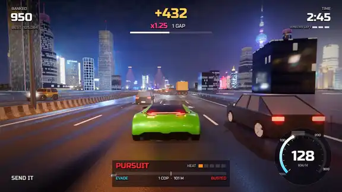
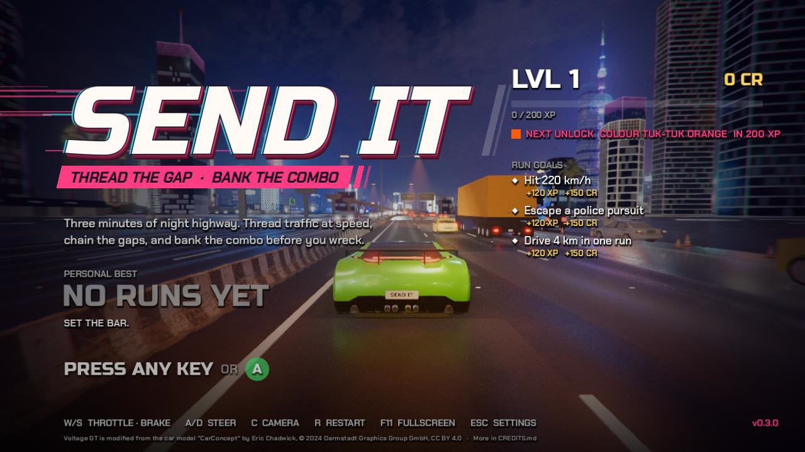
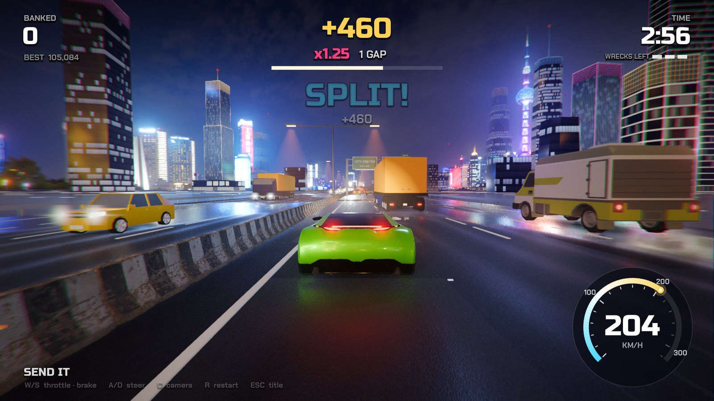
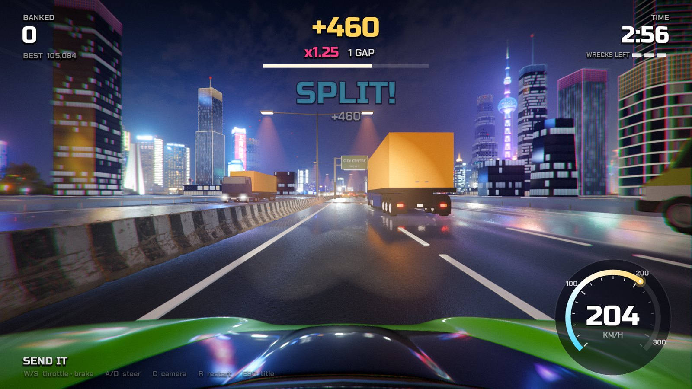
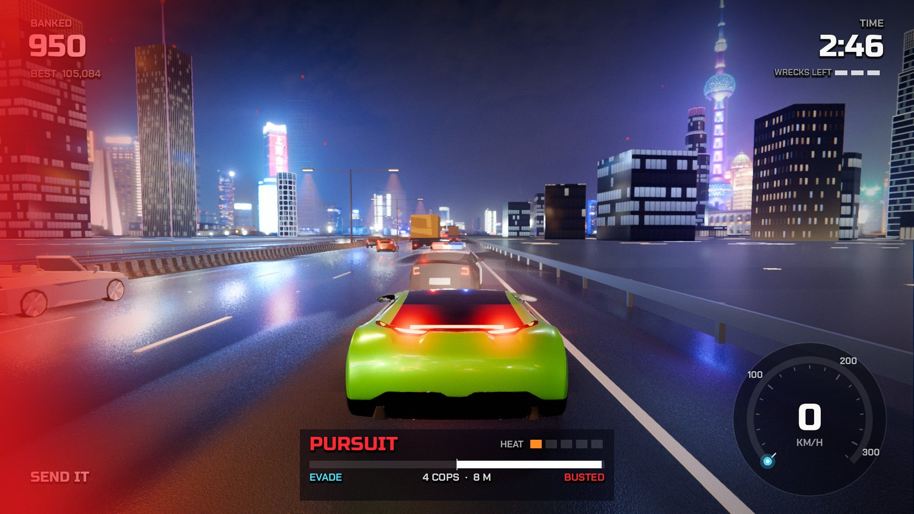
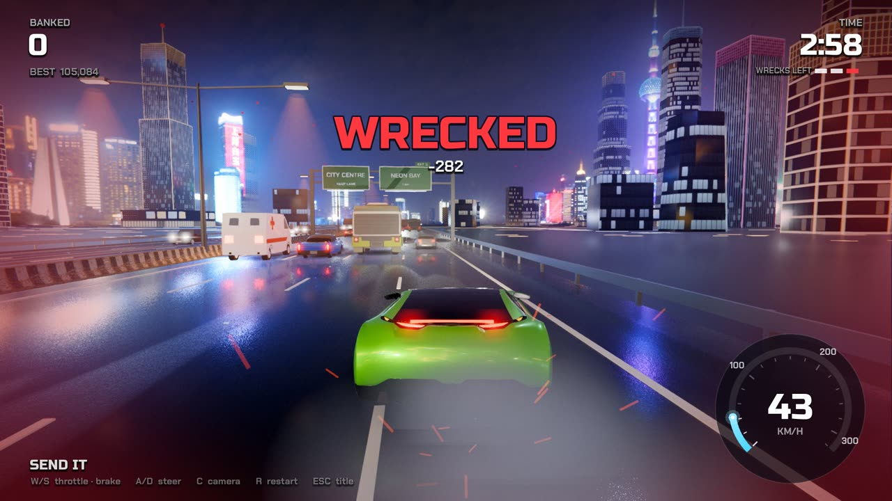
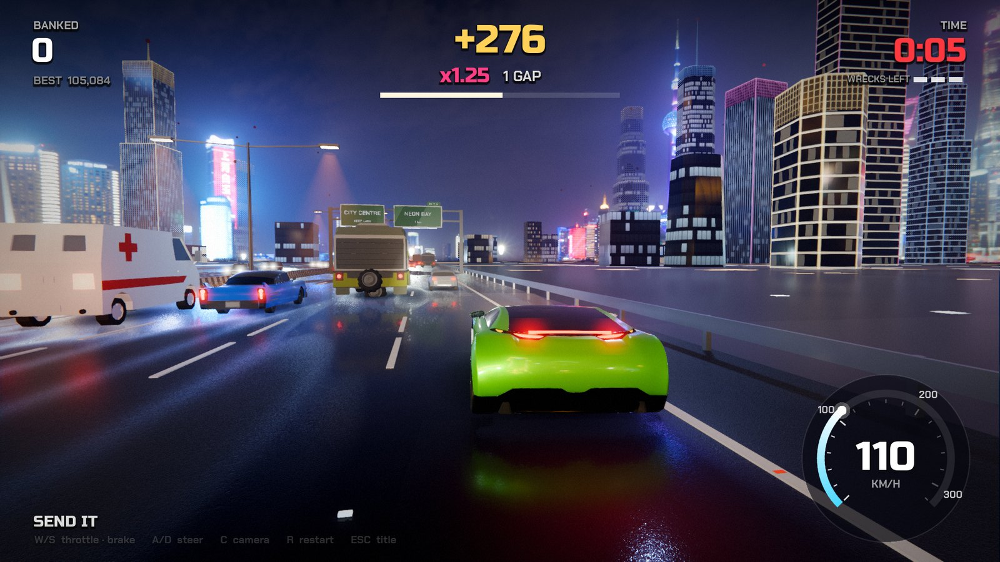
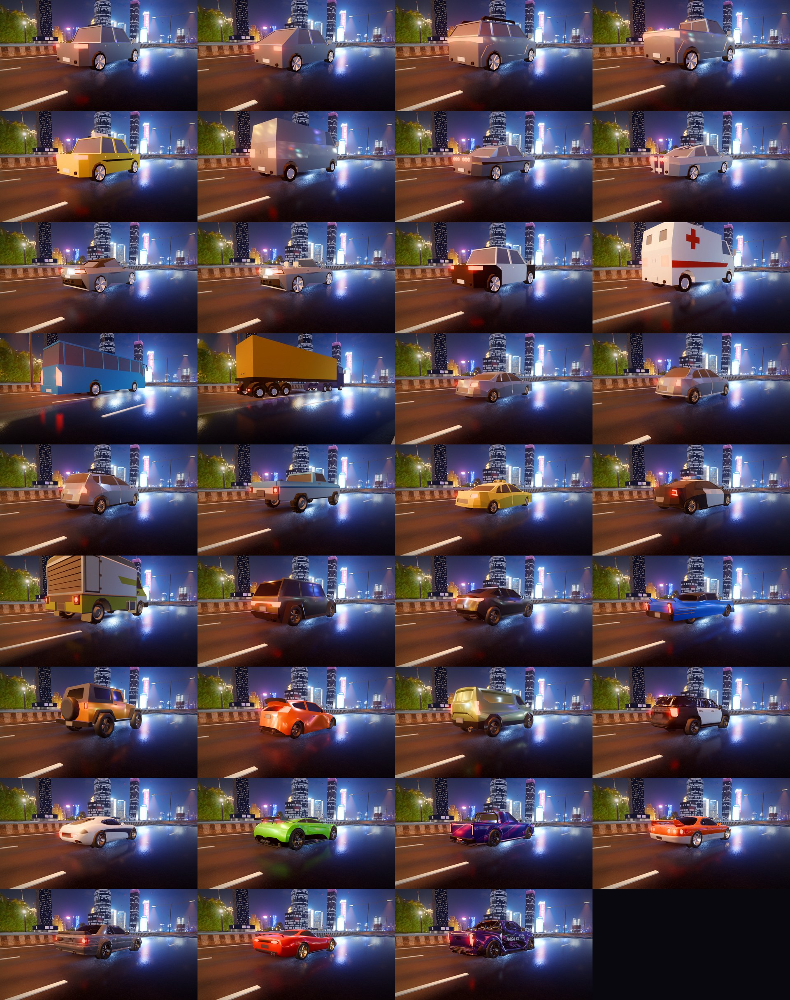

<p align="center">
  
</p>

<h1 align="center">SendIt</h1>

<p align="center">
  <b>A night-highway traffic racer. Thread the gaps, chain the combo, bank it before you wreck.</b><br>
  Three minutes, three lives, 84 cars of traffic and a police force that wants a word. Free, open source, Godot 4.
</p>

<p align="center">
  <a href="https://github.com/jedbrnth-eng/sendit/actions/workflows/ci.yml"></a>
  <a href="https://github.com/jedbrnth-eng/sendit/releases/latest"></a>
  <a href="https://github.com/jedbrnth-eng/sendit/releases"></a>
  
  
  <a href="LICENSE"></a>
</p>

<p align="center">
  <a href="#download-no-terminal-needed">Download</a> ·
  <a href="#how-to-play">How to play</a> ·
  <a href="#controls">Controls</a> ·
  <a href="#screenshots">Screenshots</a> ·
  <a href="#performance">Performance</a> ·
  <a href="#faq">FAQ</a> ·
  <a href="#how-it-works">How it works</a> ·
  <a href="#build-from-source">Build</a>
</p>

<p align="center">
  <a href="docs/demo.mp4"></a><br>
  <sub>Autopilot run rendered by the game itself (a light preview, 512×288 at 16 fps). <a href="docs/demo.mp4">Watch the 13-second video in full quality</a>.</sub>
</p>

> **Status: early release (0.1).** Playable start to finish, but expect rough edges. Issues and pull requests are welcome.

---

<p align="center">
  <a href="https://github.com/jedbrnth-eng/sendit/releases/latest/download/SendIt-macOS.zip"></a>
  &nbsp;
  <a href="https://github.com/jedbrnth-eng/sendit/releases/latest/download/SendIt-Windows-x86_64.zip"></a>
  &nbsp;
  <a href="https://github.com/jedbrnth-eng/sendit/releases/latest/download/SendIt-Linux-x86_64.tar.gz"></a><br>
  <sub>Free · about 150 MB · macOS 12+ (Apple Silicon or Intel) · Windows 10+ (64-bit) · Linux (x86-64)</sub>
</p>

## Download (no terminal needed)

SendIt isn't code-signed or notarized yet, so Mac and Windows show a one-time warning. It's expected, and the steps below get past it.

**Mac**
1. Click **Download for Mac**. `SendIt-macOS.zip` lands in your Downloads folder and usually unzips by itself.
2. Drag **SendIt** onto **Applications** (or leave it where it is).
3. Open it. macOS will say it can't verify the app. Click **Done**, open **System Settings → Privacy & Security**, scroll down and click **Open Anyway** next to SendIt, then confirm. You only do this once.

**Windows**
1. Click **Download for Windows**, then right-click the zip and choose **Extract All**.
2. Open the new folder and double-click **SendIt.exe**.
3. If Windows says "Windows protected your PC", click **More info**, then **Run anyway**.

**Linux**
```bash
tar xzf SendIt-Linux-x86_64.tar.gz
cd SendIt-*-Linux-x86_64
./SendIt.x86_64
```

### Or install with one command (Mac and Linux)

Open **Terminal** (on a Mac: press `⌘ Space`, type `Terminal`, press Return), paste this line and press Return:

```bash
curl -fsSL https://raw.githubusercontent.com/jedbrnth-eng/sendit/main/install.sh | bash
```

It downloads the latest release, **verifies it against the published checksum**, installs it (to Applications on a Mac, to `~/.local/share/sendit` on Linux) and opens it. On a Mac it also clears the download flag, so there is no Open Anyway step. Want to read it first? It's [install.sh](install.sh), about 70 lines.

<sub>Every release lists a `SHA256SUMS` file so you can check your download (`shasum -a 256 -c SHA256SUMS`). You need a GPU with Vulkan 1.2 drivers on Windows and Linux (any PC from the last several years); Macs use Metal. Only tested on an Apple M4 Max so far, so [tell us](https://github.com/jedbrnth-eng/sendit/issues/new/choose) how it runs on your machine.</sub>

## How to play

You have **three minutes** and **three wrecks**. Drive fast down a rain-slick highway and slip through the gaps between cars.

- **Thread gaps.** Pass traffic above 80 km/h with a close clearance to score. The faster and tighter the pass, the more it's worth, and squeezing between two cars (a **SPLIT**) pays extra.
- **Chain the combo.** Each gap in a row raises your multiplier. The combo points stay *live* while the 3-second window is open.
- **Bank it.** When the window runs out without a wreck, the points are banked for good. A wreck wipes whatever is still live and costs a life.
- **Watch for the police.** Pass a patrol car above 140 km/h and it gives chase: chasers weave through traffic, box you in and ram. Fill the **BUSTED** half of the meter and the run is over; keep your foot down and fill **EVADE** to escape for a bonus.

Your personal best is saved on your computer and shown on the title screen.

## Controls

| Key | Action |
|---|---|
| `W` / `↑` | Throttle |
| `S` / `↓` | Brake |
| `A` `D` / `←` `→` | Steer |
| `Space` | Handbrake |
| `C` | Change camera (chase, hood) |
| `R` | Restart the run |
| `F11` or `Alt`+`Enter` | Fullscreen |
| `Esc` | Back to the title screen |

Gamepads work too: right and left trigger for throttle and brake, left stick to steer, **A** for handbrake, **Y** for camera, **Start** to restart.

## Screenshots

<table>
  <tr>
    <td></td>
    <td></td>
  </tr>
  <tr>
    <td></td>
    <td></td>
  </tr>
  <tr>
    <td></td>
    <td></td>
  </tr>
</table>

<sub>All images are unedited frames rendered by the game (version 0.1.0) with the autopilot driving, so the car is not always at full speed.</sub>

<details>
<summary>The whole fleet: all 28 vehicle models, rear three-quarter view</summary>

<p align="center">
  
</p>

Rendered with `tools/wheel_sheet.tscn`. The tests also audit every model's wheels numerically.

</details>

## Performance

Measured from the exported macOS build with the game's built-in frame probe (`PERF` line): 1920×1080, autopilot driving 2,400 physics frames, vsync on, on an **Apple M4 Max MacBook Pro** while the machine was also busy with other work (load average about 8), so treat these as a floor, not a best case.

| Run | Average frame rate | Worst frame | Draw calls per frame | Objects per frame |
|---|---|---|---|---|
| Seed 7 | 87 fps | 43 ms | about 3,500 | about 5,600 |
| Seed 23 | 74 fps | 40 ms | about 3,600 | about 5,700 |

Every frame draws roughly 3,500 objects with about 785,000 triangles, so the game is **GPU-heavy by design**: Forward+ rendering, 2× MSAA, glow, screen-space reflections, SSAO, volumetric fog and dense traffic. I haven't measured any other hardware yet and there is no quality menu in 0.1, so older or integrated GPUs may run it slowly. If you try it, please [open an issue](https://github.com/jedbrnth-eng/sendit/issues/new/choose) with your frame rate.

## What's inside

- **A streamed highway.** A 4+4 lane road generated as you drive, with sign gantries, sodium lamp pools, wet-road reflections and a procedural glass skyline matched to a Shanghai night HDRI.
- **Traffic with manners.** 84 cars follow each other with the Intelligent Driver Model, change lanes only when there's room, and get knocked aside when you hit them.
- **Police with a plan.** Patrols and parked cops, a chase brain that weaves, boxes and rams, heat levels, and difficulty that grows with distance.
- **27 vehicle models** with glowing lamps and flares, rolling and steering wheels, and an engine sound model with gears and a redline, plus recorded pass-by, crash and siren audio.
- **Smooth by design.** Physics interpolation, a camera that follows the interpolated car, ramped keyboard steering and eased lane changes, each covered by tests.

## How it works

```
Boot (input map, launch args) ─► Main ─► Highway (streams road + city around the player)
                                    ├──► PlayerCar ── ChaseCamera / hood cam
                                    ├──► TrafficManager ── IDM following, lane changes, gap detection
                                    │                        └─► GapScorer ─► RunSession ─► BestStore
                                    ├──► PoliceManager ── patrols, chase brain, Pursuit (heat, EVADE / BUSTED)
                                    └──► HUD · Title · Results · Audio
```

- **Scenes are built in code**, so every change shows up in a diff. `main.tscn` is a single node.
- **`CarModel`** normalises any glTF car: it scales to a target length, finds where the tyres touch the road, adds lamp lenses and flares, and rigs each wheel with a spin pivot (single tyres and whole-axle meshes both work).
- **`GapScorer`** is pure logic with no nodes, so the scoring maths is unit-tested directly.
- **Audio** is mixed in a bus layout with a hard limiter, per-gear engine loops and recorded pass-by clips.

## Testing

`tools/gate.sh` is the one command that matters. It imports the project, runs **107 unit tests** headless, then drives the car on autopilot for 600 frames and fails on any `SCRIPT ERROR` or `ERROR` line. CI runs it on every push and pull request; the Release workflow runs it again, exports all three platforms, and launches each exported build on its own operating system before publishing.

Notable tests: scoring maths, traffic and highway streaming, police rules and chase brain, handling and smoothness guarantees, audio loop import settings (a past click bug), a wheel-rig audit of every traffic model at every spin angle, and a licence check that every asset is credited.

## Build from source

You need [Godot 4.7](https://godotengine.org/download) (standard build, not .NET).

```bash
git clone https://github.com/jedbrnth-eng/sendit.git
cd sendit
godot --path .                 # play
tools/gate.sh                  # tests + headless smoke run
scripts/export.sh              # build the three downloads into dist/ (needs the export templates; macOS build needs a Mac)
```

The first launch imports about 350 MB of assets, which takes a minute. See [CONTRIBUTING.md](CONTRIBUTING.md) for launch arguments, the project layout and how to capture before/after frames.

## FAQ

**Is it safe? Windows and macOS warn me.**
The warnings appear because the download isn't code-signed or notarized (that costs money each year). The source is all here, every release is built by the public [Release workflow](.github/workflows/release.yml), and `SHA256SUMS` lets you check your download. The one-line installer verifies it for you.

**It won't start, or it's slow.**
It needs Vulkan 1.2 drivers on Windows and Linux (Metal on a Mac). Update your graphics driver first. If it's still slow or crashes, open a bug report and include your GPU and frame rate.

**Where is my best score saved? How do I reset it?**
In Godot's per-user data folder as `best.cfg`: `~/Library/Application Support/Godot/app_userdata/SendIt` on a Mac, `%APPDATA%\Godot\app_userdata\SendIt` on Windows, `~/.local/share/godot/app_userdata/SendIt` on Linux. Delete the file to reset.

**Does it work with a controller?**
Yes. See [Controls](#controls).

**Can I mod it or use the assets?**
The code is MIT. Each asset keeps its own licence, listed in [CREDITS.md](CREDITS.md) (mostly CC0). The hero car needs attribution (CC BY 4.0).

**Is there multiplayer, a car selector, or more tracks?**
Not yet. 0.1 is one track, one car and a three-minute score attack. Ideas are welcome as [feature requests](https://github.com/jedbrnth-eng/sendit/issues/new/choose).

## Privacy

SendIt is an offline single-player game: no account, no analytics, no telemetry and no network requests. The only file it writes is your personal best (`best.cfg`) in Godot's per-user data folder.

## Project layout

```
scripts/       game code (core, world, vehicle, traffic, police, score, ui, audio)
assets/        models, textures, HDRIs, audio, fonts and icon (every file credited in CREDITS.md)
tests/         unit tests (run by tools/gate.sh)
tools/         gate, capture, probes and asset scripts
install.sh     one-line installer for macOS and Linux (checksum-verified)
scripts/ci/    pinned Godot install, exported-build smoke tests, installer test, Windows exe check
.github/       CI and Release workflows, issue and PR templates
```

## Credits

Cars, city kit, textures, HDRIs, sounds and fonts come from CC0 and openly licensed packs by Kenney, Quaternius, Poly Haven, ambientCG, BigSoundBank and others. The hero car, *CarConcept* by Eric Chadwick (© 2024 Darmstadt Graphics Group GmbH), is [CC BY 4.0](https://creativecommons.org/licenses/by/4.0/). The full list with links and licences is in [`CREDITS.md`](CREDITS.md). All brands in the game are fictional.

## License

[MIT](LICENSE) © 2026 Jed Brown. Third-party work keeps its own licence, listed in [`CREDITS.md`](CREDITS.md).
