<p align="center">
  
</p>

<h1 align="center">SendIt</h1>

<p align="center">
  <b>A night-highway traffic racer. Thread the gaps, chain the combo, bank it before you wreck.</b><br>
  Three minutes, three lives, 84 cars of traffic, junk on the hard shoulder and a police force that wants a word. Six cars to unlock and tune, mirrors to watch your back and a replay of your best gaps. Free, open source, Godot 4.
</p>

<p align="center">
  <a href="https://github.com/jedbrnth-eng/sendit/actions/workflows/ci.yml"></a>
  <a href="https://github.com/jedbrnth-eng/sendit/releases/latest"></a>
  <a href="https://github.com/jedbrnth-eng/sendit/releases"></a>
  
  
  <a href="LICENSE"></a>
</p>

<p align="center">
  <a href="#download-no-terminal-needed">Download</a> ·
  <a href="#how-to-play">How to play</a> ·
  <a href="#controls">Controls</a> ·
  <a href="#screenshots">Screenshots</a> ·
  <a href="#performance">Performance</a> ·
  <a href="#faq">FAQ</a> ·
  <a href="#how-it-works">How it works</a> ·
  <a href="#build-from-source">Build</a>
</p>

<p align="center">
  <a href="docs/demo.mp4"></a><br>
  <sub>Rendered by the game itself, autopilot driving (a light preview, 512×288 at 16 fps, 15 seconds). <a href="docs/demo.mp4">Watch the 34-second video in full quality</a>.</sub>
</p>

> **Status: early release (0.3).** New in 0.3: rear-view and side mirrors, an end-of-round replay cam, the Naga XR pickup, rebuilt Kaze RT and Kaiju R, a Thai roadside and two new police cars at high heat. Playable start to finish, but expect rough edges. Issues and pull requests are welcome.

---

<p align="center">
  <a href="https://github.com/jedbrnth-eng/sendit/releases/latest/download/SendIt-macOS.zip"></a>
  &nbsp;
  <a href="https://github.com/jedbrnth-eng/sendit/releases/latest/download/SendIt-Windows-x86_64.zip"></a>
  &nbsp;
  <a href="https://github.com/jedbrnth-eng/sendit/releases/latest/download/SendIt-Linux-x86_64.tar.gz"></a><br>
  <sub>Free · 165 to 195 MB · macOS 12+ (Apple Silicon or Intel) · Windows 10+ (64-bit) · Linux (x86-64)</sub>
</p>

## Download (no terminal needed)

SendIt isn't code-signed or notarized yet, so Mac and Windows show a one-time warning. It's expected, and the steps below get past it.

**Mac**
1. Click **Download for Mac**. `SendIt-macOS.zip` lands in your Downloads folder and usually unzips by itself.
2. Drag **SendIt** onto **Applications** (or leave it where it is).
3. Open it. macOS will say it can't verify the app. Click **Done**, open **System Settings → Privacy & Security**, scroll down and click **Open Anyway** next to SendIt, then confirm. You only do this once.

**Windows**
1. Click **Download for Windows**, then right-click the zip and choose **Extract All**.
2. Open the new folder and double-click **SendIt.exe**.
3. If Windows says "Windows protected your PC", click **More info**, then **Run anyway**.

**Linux**
```bash
tar xzf SendIt-Linux-x86_64.tar.gz
cd SendIt-*-Linux-x86_64
./SendIt.x86_64
```

### Or install with one command (Mac and Linux)

Open **Terminal** (on a Mac: press `⌘ Space`, type `Terminal`, press Return), paste this line and press Return:

```bash
curl -fsSL https://raw.githubusercontent.com/jedbrnth-eng/sendit/main/install.sh | bash
```

It downloads the latest release, **verifies it against the published checksum**, installs it (to Applications on a Mac, to `~/.local/share/sendit` on Linux) and opens it. On a Mac it also clears the download flag, so there is no Open Anyway step. Want to read it first? It's [install.sh](install.sh), about 70 lines.

<sub>Every release lists a `SHA256SUMS` file so you can check your download (`shasum -a 256 -c SHA256SUMS`). You need a GPU with Vulkan 1.2 drivers on Windows and Linux (any PC from the last several years); Macs use Metal. Only tested on an Apple M4 Max so far, so [tell us](https://github.com/jedbrnth-eng/sendit/issues/new/choose) how it runs on your machine.</sub>

## How to play

You have **three minutes** and **three wrecks**. Drive fast down a rain-slick highway and slip through the gaps between cars.

- **Thread gaps.** Pass traffic above 80 km/h with a close clearance to score. The faster and tighter the pass, the more it's worth, and squeezing between two cars (a **SPLIT**) pays extra.
- **Chain the combo.** Each gap in a row raises your multiplier. The combo points stay *live* while the 3-second window is open.
- **Bank it.** When the window runs out without a wreck, the points are banked for good. A wreck wipes whatever is still live and costs a life.
- **Watch for the police.** Pass a patrol car above 140 km/h and it gives chase: chasers weave through traffic, box you in and ram. At higher heat an interceptor SUV and a pursuit coupe join in. Fill the **BUSTED** half of the meter and the run is over; keep your foot down and fill **EVADE** to escape for a bonus. Check your mirrors: their frames flash red and blue when a lit cop is behind you.
- **Mind the shoulder.** Cones, barrels, debris, signs, water barriers and broken-down cars sit on the hard shoulder. Hit one and it's a wreck, and gaps don't score while you ride the shoulder.

**Level up between runs.** Every run pays XP and credits for your banked score, gaps, distance, best combo, police escapes and a clean run, plus three run goals at a time. Levels unlock 70 items: five more cars plus paint colours, finishes, wraps, rims, headlights, underglow, exhaust flames, engine tones and number plates; spend credits to buy them, then fit them to each car in the garage. Every round has a fresh random layout of traffic and hazards.

When the round ends, the **replay cam** shows your best gaps from trackside cameras before the results.

Your level, credits, garage and personal best are saved on your computer and shown on the title screen.

## Controls

| Key | Action |
|---|---|
| `W` / `↑` | Throttle |
| `S` / `↓` | Brake |
| `A` `D` / `←` `→` | Steer |
| `Space` | Handbrake |
| `C` | Change camera (chase, hood) |
| `M` | Mirrors: off, rear-view only, rear-view and side mirrors |
| `R` | Restart the run; on the results screen, watch the replay again |
| `Enter` / `Space` / `Esc` | Skip the replay |
| `F11` or `Alt`+`Enter` | Fullscreen (saved, same as the setting) |
| `Esc` | Pause menu during a run (resume, settings, restart, quit to title); settings on the title screen |
| Any other key | Title screen: go to car select |

**Car select and garage:** `A` `D` or arrows to change car or item, `Q` `E` to switch tabs (CAR, PAINT, WHEELS, LIGHTS, EXTRAS), `W` `S` to pick a row, `Enter` to buy or fit an item (or drive, on the CAR tab), `Space` to drive from any tab, `Esc` to go back.

Gamepads work too: right and left trigger for throttle and brake, left stick to steer, **A** for handbrake, **Y** for camera, **Start** to restart, **Back** to pause. In menus, the d-pad or stick moves, **A** accepts, **B** goes back, **LB** and **RB** switch garage tabs. Keyboard controls can be rebound in Settings.

## Screenshots

<table>
  <tr>
    <td></td>
    <td>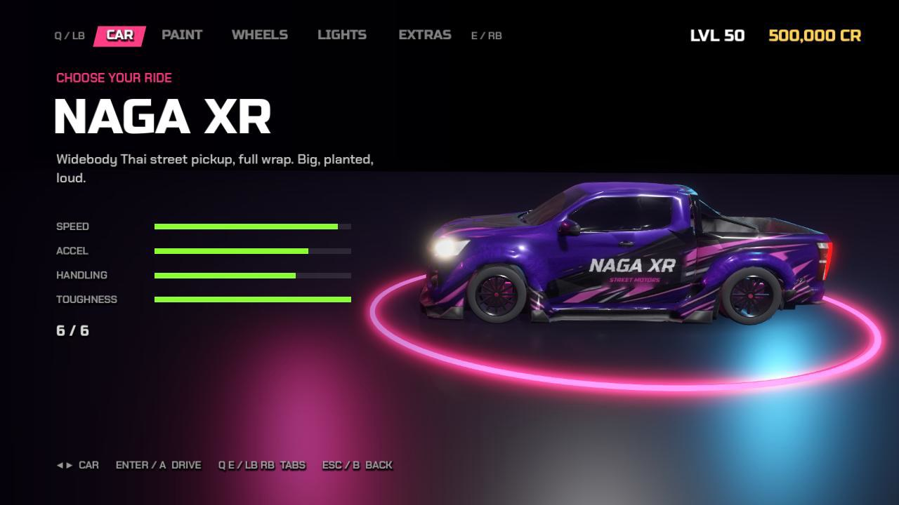</td>
  </tr>
  <tr>
    <td>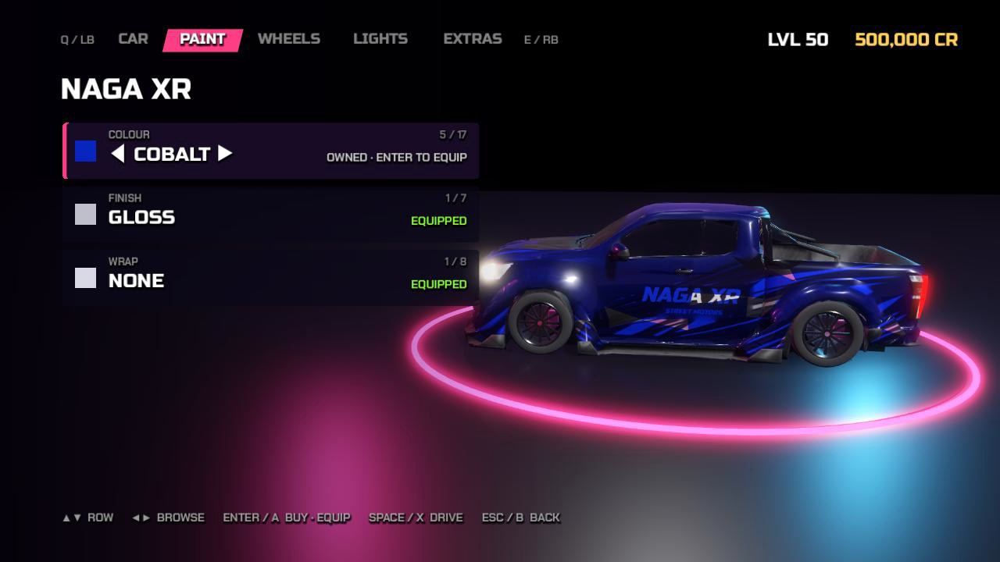</td>
    <td>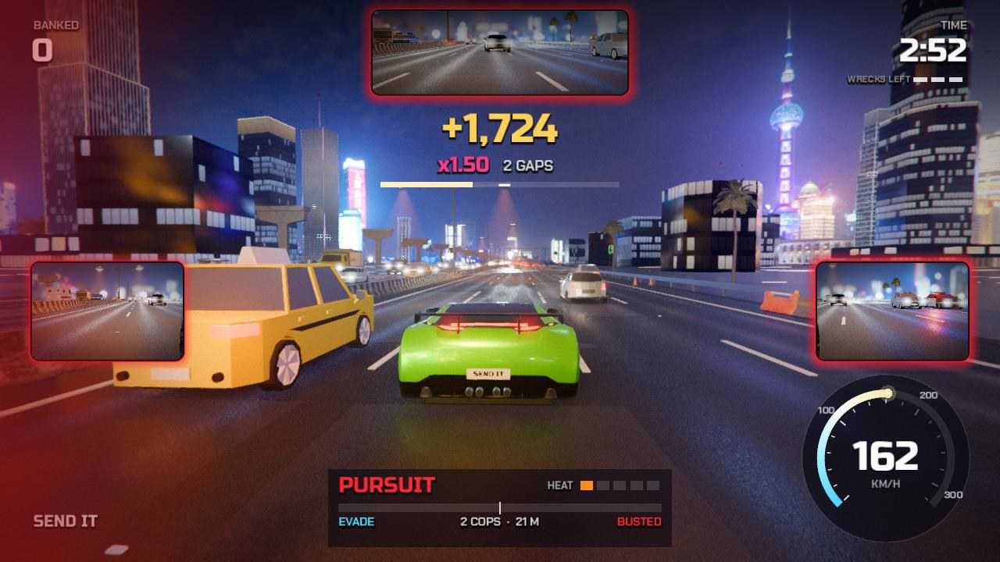</td>
  </tr>
  <tr>
    <td>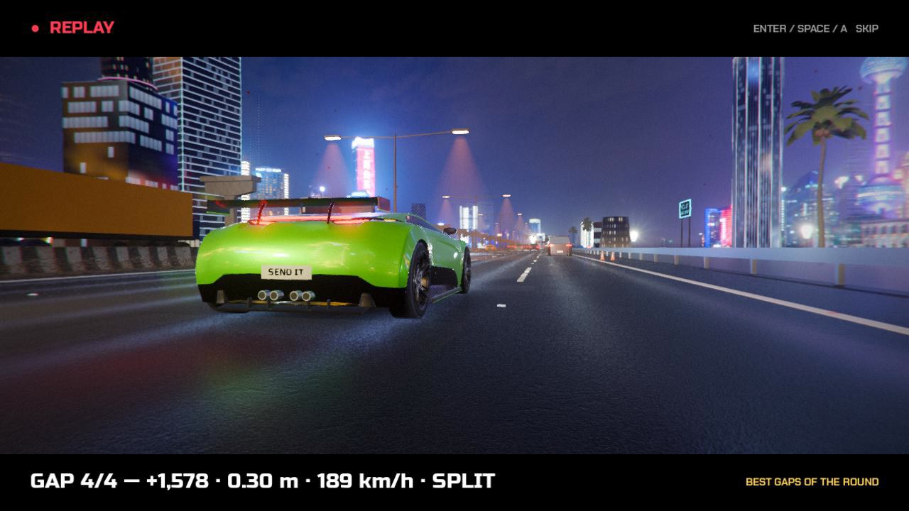</td>
    <td>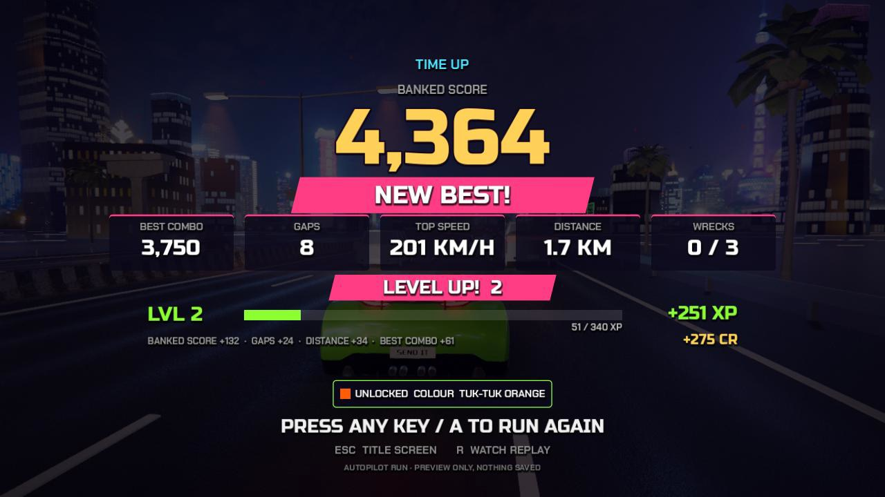</td>
  </tr>
  <tr>
    <td>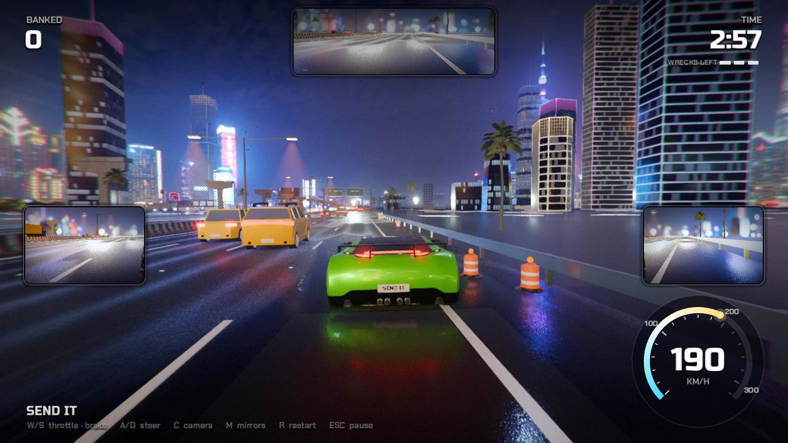</td>
    <td>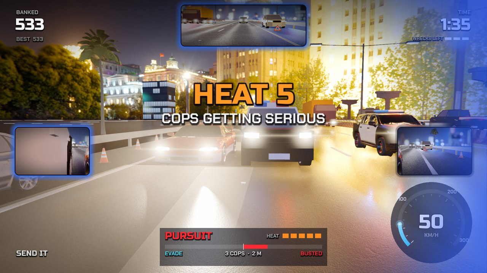</td>
  </tr>
  <tr>
    <td>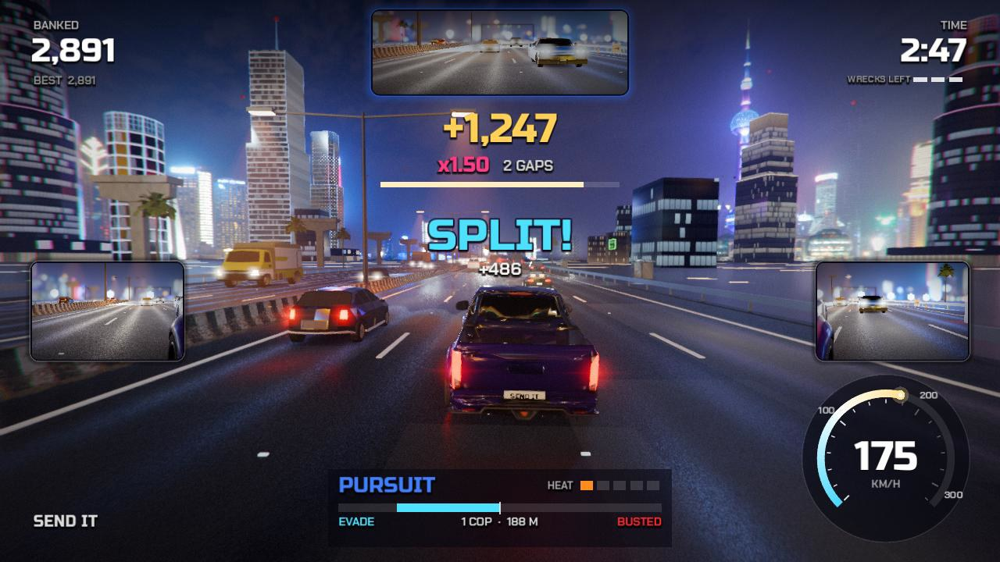</td>
    <td>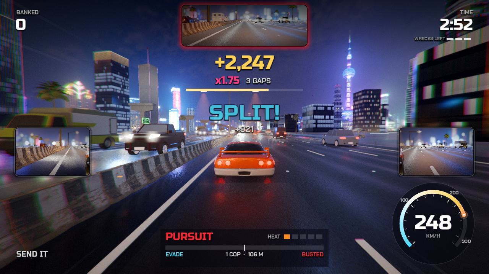</td>
  </tr>
  <tr>
    <td>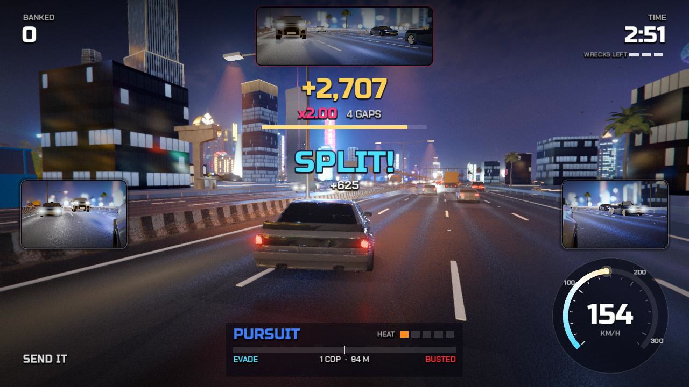</td>
    <td>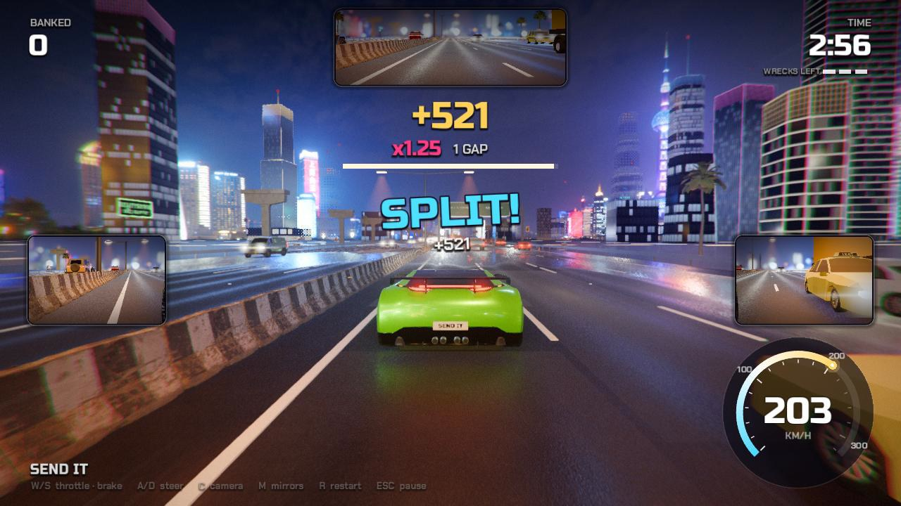</td>
  </tr>
  <tr>
    <td>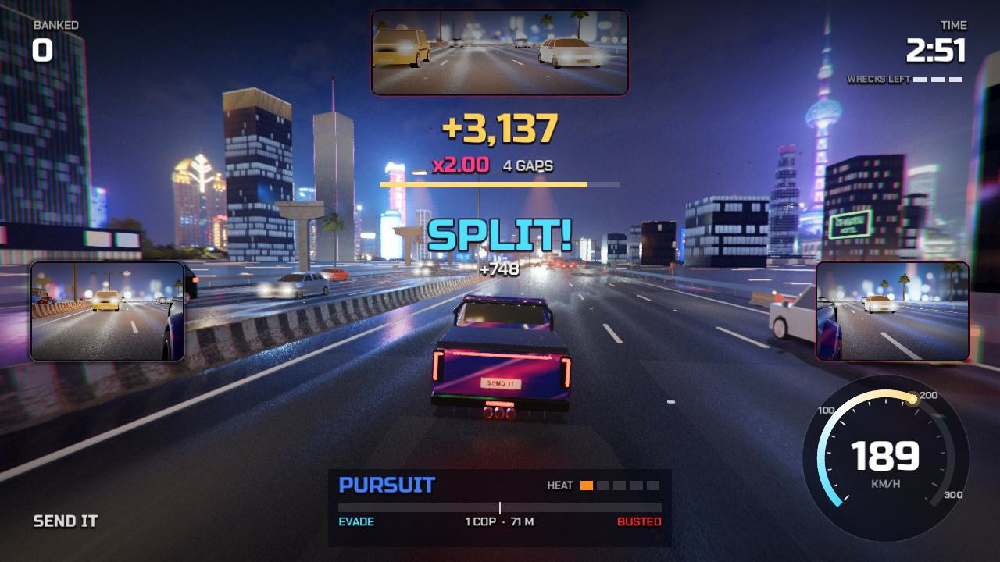</td>
    <td>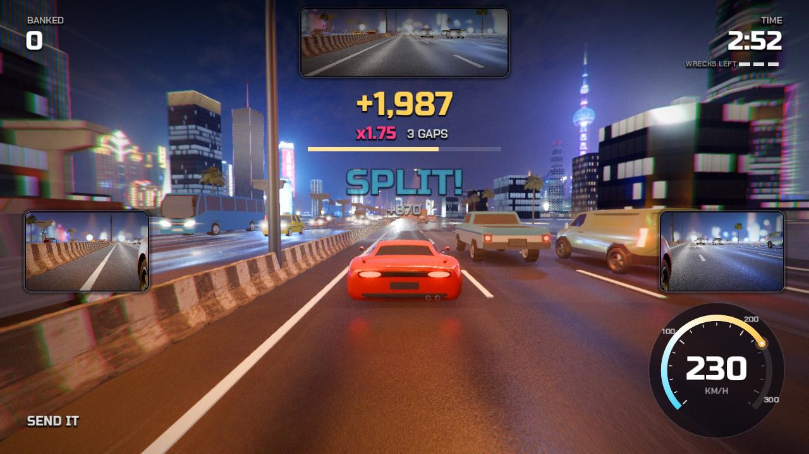</td>
  </tr>
</table>

<sub>All images are unedited frames rendered by the game (version 0.3.0). Driving shots are autopilot runs, so the car is not always at full speed; the title and results shots use a fresh profile, the garage shots a test profile with everything unlocked.</sub>

<details>
<summary>The whole fleet: all 35 vehicle models, rear three-quarter view</summary>

<p align="center">
  
</p>

Rendered with `tools/wheel_sheet.tscn`. The tests also audit every traffic model's wheels numerically.

</details>

## Performance

Measured on an **Apple M4 Max MacBook Pro**, running from source with `tools/perf.sh`: 1920×1080, vsync off, autopilot driving 1,500 frames on seed 7 with a forced police pursuit, while the machine's load average was between 3.4 and 4.6 (other work was running). Each row is the median of 3 to 8 runs taken back to back, alternating the settings.

| Build and mirrors | Average frame time | Draw calls per frame | Triangles per frame |
|---|---|---|---|
| 0.2.0, no mirrors | 8.3 ms | about 3,600 | about 700,000 |
| 0.3.0, mirrors off | 8.4 ms | about 3,600 | about 820,000 |
| 0.3.0, rear-view only | 9.2 ms | about 4,200 | about 910,000 |
| 0.3.0, all three mirrors (default) | 9.1 ms | about 4,200 | about 920,000 |

The mirrors cost about 0.7 ms a frame here. Only one mirror view is drawn per frame, so all three cost about the same as the rear-view alone. Hitches were the bigger problem. In one 4-minute pursuit that reached heat 4, two frames took 66 and 70 ms. Building a new police car for the first time takes about 100 ms, and loading a prop for the first time takes 10 to 60 ms. 0.3.0 now does both when the round starts, and the worst frame in the same run dropped to 31 ms. A few 25 to 35 ms frames remain (0.2.0 has them too).

The game is **GPU-heavy by design**: Forward+ rendering, 2× MSAA, glow, screen-space reflections, SSAO, volumetric fog and dense traffic. On a slower GPU, open **Settings** (`Esc` on the title screen) and try the **LOW** quality preset (it also turns the side mirrors off and keeps the rear-view), set **Mirrors** to REAR or OFF, or lower shadows, glow and draw distance. I haven't measured any other hardware yet, so if you try it, please [open an issue](https://github.com/jedbrnth-eng/sendit/issues/new/choose) with your frame rate.

## What's inside

- **A streamed highway.** A 4+4 lane road generated as you drive, with sign gantries, sodium lamp pools, wet-road reflections and a procedural glass skyline matched to a Shanghai night HDRI.
- **Traffic with manners.** 84 cars follow each other with the Intelligent Driver Model, change lanes only when there's room, and get knocked aside when you hit them.
- **Police with a plan.** Patrols and parked cops, a chase brain that weaves, boxes and rams, heat levels that bring in faster units, and difficulty that grows with distance.
- **Hazards on the hard shoulder.** Cones, drum barrels, tyres, crates, pallets, planks, ladders, chevron signs, warning triangles, water and Jersey barriers and broken-down cars, laid out from each round's seed.
- **A Thai roadside.** Palms, bus shelters, motorbike-taxi stands, spirit-house shrines, food stalls, parked tuk-tuks, neon shop signs in Thai and English, bare expressway piers and lane-signal gantries beyond the barriers.
- **Mirrors.** A rear-view mirror and two side mirrors (`M` cycles off, rear-view only, all three). The frame flashes red and blue when a lit police car is behind you.
- **Replay cam.** At the end of a round the game replays up to four of your best gaps from trackside cameras, with a slow-motion moment and a caption. Press `R` on the results screen to watch it again, or turn it off in Settings.
- **Six drivable cars** with their own handling, hitbox, camera and engine pitch: the **Voltage GT** (the all-rounder), the **Naga X** widebody pickup, the **Kaze RT** fastback (top speed), the boxy **Kaiju R** (heavy, hard to kill), the light, twitchy **Rotor FX** and the wrapped **Naga XR** street pickup (level 20). The Naga X and Rotor FX are built by the Blender scripts in `tools/blender/`; the Naga XR, Kaze RT and Kaiju R were made with Meshy and cleaned up by the scripts in `tools/meshy/`.
- **A garage and progression.** Levels, XP, credits, run goals and 80 garage items (10 starters, 70 to earn, cars included), each car with its own loadout, saved to `profile.cfg`.
- **Settings.** Volume (master, music, effects), a quality preset or separate shadows, glow and draw distance, mirrors and mirror size, replay on or off, fullscreen, field of view, starting camera and keyboard rebinding, saved to `settings.cfg`.
- **29 traffic and police models** (including an interceptor SUV from heat 3 and a pursuit coupe from heat 4) with glowing lamps and flares, rolling and steering wheels, and an engine sound model with gears and a redline, plus recorded pass-by, crash and siren audio.
- **Collisions that follow the car's angle.** Contacts use rotated, body-sized boxes, so a car turned mid lane-change hits where it looks like it should, and a car you hit stays solid.
- **Smooth by design.** Physics interpolation, a camera that follows the interpolated car, ramped keyboard steering and eased lane changes, each covered by tests.

## How it works

```
Boot (input map, launch args, Settings) ─► Main ─► Highway (streams road + city around the player)
                                             ├──► ShoulderHazards (seeded per round) · RoadsideProps (PropKit)
                                             ├──► PlayerCar (CarCatalog + CarStyle) ── ChaseCamera / hood cam
                                             ├──► TrafficManager ── IDM following, lane changes, oriented-box contacts
                                             │      └─► PassRules ─► GapScorer ─► RunSession ─► BestStore
                                             ├──► PoliceManager ── patrols, chase brain, Pursuit (heat, EVADE / BUSTED), PoliceFleet
                                             ├──► Mirrors (rear-view + side SubViewports) · ReplayRecorder ─► ReplayDirector
                                             ├──► RunReward ─► Profile (XP, credits, unlocks, goals) ─► ProfileStore
                                             └──► Title · CarSelect (garage) · HUD · Pause / Settings · Results · Audio
```

- **Scenes are built in code**, so every change shows up in a diff. `main.tscn` is a single node.
- **`CarModel`** normalises any glTF car: it scales to a target length, finds where the tyres touch the road, adds lamp lenses and flares, and rigs each wheel with a spin pivot (single tyres and whole-axle meshes both work).
- **`GapScorer`**, **`PassRules`**, **`RunReward`**, **`XpCurve`**, **`UnlockCatalog`** and **`Settings`** are pure logic with no nodes, so scoring, rewards and settings are unit-tested directly.
- **Audio** is mixed in a bus layout with a hard limiter, per-gear engine loops and recorded pass-by clips.

## Testing

`tools/gate.sh` is the one command that matters. It imports the project, runs **231 unit tests** headless, then drives the car on autopilot for 600 frames and fails on any `SCRIPT ERROR` or `ERROR` line. CI runs it on every push and pull request; the Release workflow runs it again, exports all three platforms, and launches each exported build on its own operating system before publishing.

Notable tests: scoring maths and pass validity, mirror modes and per-car mirror anchors, the replay recorder (bounded memory, 30 Hz sampling, it never changes the run) and its highlight picker, Meshy model budgets (triangles, file size, our own material names, no brand words), rotated-box contacts (including the struck-car exploit), shoulder hazards, XP and credit caps, unlocks and goals, profile and settings save files (including a corrupt file), traffic and highway streaming, police rules and chase brain, handling and smoothness guarantees, audio loop import settings (a past click bug), a wheel-rig audit of every traffic model at every spin angle, and a licence check that every asset is credited.

## Build from source

You need [Godot 4.7](https://godotengine.org/download) (standard build, not .NET).

```bash
git clone https://github.com/jedbrnth-eng/sendit.git
cd sendit
godot --path .                 # play
tools/gate.sh                  # tests + headless smoke run
scripts/export.sh              # build the three downloads into dist/ (needs the export templates; macOS build needs a Mac)
```

The first launch imports about 150 MB of assets, which takes a minute. See [CONTRIBUTING.md](CONTRIBUTING.md) for launch arguments, the project layout and how to capture before/after frames.

## FAQ

**Is it safe? Windows and macOS warn me.**
The warnings appear because the download isn't code-signed or notarized (that costs money each year). The source is all here, every release is built by the public [Release workflow](.github/workflows/release.yml), and `SHA256SUMS` lets you check your download. The one-line installer verifies it for you.

**It won't start, or it's slow.**
It needs Vulkan 1.2 drivers on Windows and Linux (Metal on a Mac). Update your graphics driver first. If it's still slow or crashes, open a bug report and include your GPU and frame rate.

**Where is my progress saved? How do I reset it?**
In Godot's per-user data folder: `~/Library/Application Support/Godot/app_userdata/SendIt` on a Mac, `%APPDATA%\Godot\app_userdata\SendIt` on Windows, `~/.local/share/godot/app_userdata/SendIt` on Linux. `best.cfg` is your personal best, `profile.cfg` your level, credits, unlocks and loadouts, `garage.cfg` your last car and `settings.cfg` your settings. Delete a file to reset it (Settings also has a reset button for the settings).

**Does it work with a controller?**
Yes. See [Controls](#controls).

**Can I mod it or use the assets?**
The code is GPL-3.0. Each asset keeps its own licence, listed in [CREDITS.md](CREDITS.md) (mostly CC0; the Blender-built cars are original work under GPL-3.0, and the Meshy-made cars and props are owned by the project and released under GPL-3.0). The Voltage GT is modified from a CC BY 4.0 model and needs attribution.

**Is there multiplayer or more tracks?**
Not yet. 0.3 is one track, six cars with a garage, and a three-minute score attack. Ideas are welcome as [feature requests](https://github.com/jedbrnth-eng/sendit/issues/new/choose).

## Privacy

SendIt is an offline single-player game: no account, no analytics, no telemetry and no network requests. The only files it writes are `best.cfg`, `profile.cfg`, `garage.cfg` and `settings.cfg` in Godot's per-user data folder.

## Project layout

```
scripts/       game code (core, world, vehicle, traffic, police, score, progress, ui, audio)
assets/        models, textures, HDRIs, audio, fonts and icon (every file credited in CREDITS.md)
tests/         unit tests (run by tools/gate.sh)
tools/         gate, capture, perf, probes, asset scripts, the Blender car generators (tools/blender) and the Meshy clean-up pipeline (tools/meshy)
install.sh     one-line installer for macOS and Linux (checksum-verified)
scripts/ci/    pinned Godot install, exported-build smoke tests, installer test, Windows exe check
.github/       CI and Release workflows, issue and PR templates
```

## Credits

Cars, city kit, textures, HDRIs, sounds and fonts come from CC0 and openly licensed packs by Kenney, Quaternius, Poly Haven, ambientCG, BigSoundBank and others. The Voltage GT is modified from *CarConcept* by Eric Chadwick (© 2024 Darmstadt Graphics Group GmbH), [CC BY 4.0](https://creativecommons.org/licenses/by/4.0/). The Naga X and Rotor FX are original models made for SendIt in Blender. The Naga XR, Kaze RT and Kaiju R, the two new police cars and the shoulder and roadside props were generated with Meshy on the owner's paid Pro plan (whose terms give the customer ownership of the output, so they are not CC0), cleaned up by the SendIt scripts in `tools/meshy`, checked for real logos, and released under this repository's GPL-3.0. The full list with links and licences is in [`CREDITS.md`](CREDITS.md). All brands in the game are fictional.

## License

SendIt is free software under the [GNU GPL v3.0](LICENSE), © 2026 Jed Brown. You can use it, study it, change it and share it. If you pass it on, modified or not, you must keep the copyright and credit to Jed Brown, release your full source under GPL-3.0 too, and say what you changed. Cars, sounds, fonts and other third-party assets keep their own licenses, listed in [`CREDITS.md`](CREDITS.md).

Want to improve it? Please send your changes here as a pull request instead of making a separate copy ([CONTRIBUTING.md](CONTRIBUTING.md)). The SendIt name and icon are not covered by the license, so a fork needs its own.
